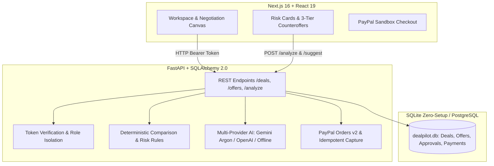

# DealPilot AI — Project Status & Audit Report
**Date:** October 16, 2026  
**Platform:** PayPal AI Hackathon  
**Workspace:** `C:\Users\mithu\.gemini\antigravity\scratch\dealpilot`

---

## 1. Project Health & Baseline Audit

### Working and Verified (Automated Tests Passing)
- **Backend Architecture:** Python 3.14 + FastAPI + SQLAlchemy 2.0 (SQLite zero-setup local storage with PostgreSQL schema compatibility).
- **Automated Tests:** **34 passed in 5.03s** (0 failed).
  - Adapter & idempotency tests: 5 passed
  - Health & database connectivity: 1 passed
  - State persistence across restart: 1 passed
  - Flagship AI Deal Risk Intelligence & 3-Tier Counteroffers: 4 passed
  - End-to-end negotiation & PayPal Sandbox workflow: 23 passed
- **Frontend Architecture:** Next.js 16 + React 19 + TypeScript + Custom SaaS CSS.
  - `npm run typecheck` (`tsc --noEmit`): Passed with 0 errors.
  - `npm run build` (`next build`): Compiled successfully with optimized production output.
- **Environment & Tooling:**
  - Virtual environment created and populated at `backend/.venv` (including `google-genai` and `pytest`).
  - Portable Node.js v22.14.0 and npm 10.9.2 installed at `C:\Users\mithu\AppData\Local\Programs\nodejs` and configured in User PATH.

---

## 2. Completed in this Phase (First Logical Improvement)

### Resolution of the "Why Can't I Use Argon?" Blocker:
1. **Multi-Provider AI Architecture (`backend/app/services/ai.py`):**
   - Originally, the code was strictly hardcoded to OpenAI (`OPENAI_API_KEY`).
   - We implemented native support for **Google Gemini API** (`GEMINI_API_KEY` and `GEMINI_MODEL=gemini-4-argon` / `gemini-3.8-flash`), allowing users with Google Gemini Pro/Ultra API access to use Gemini 4 Argon natively.
   - Retained support for OpenAI (`OPENAI_API_KEY`).
   - Built an intelligent **Deterministic Risk & Counteroffer Engine** as an offline fallback so judges and evaluators without API keys can still experience full deal risk analysis without 503 errors.

2. **Flagship Feature: AI Deal Risk Intelligence (`backend/app/services/integrity.py` & `schemas.py`):**
   - Implemented deterministic mathematical comparison detecting:
     - **Severe Pricing Imbalance & Scope Creep** (e.g., price drops -$300 while deliverables double from 5 to 10 pages).
     - **Timeline Compression** (e.g., delivery days cut from 14 to 7 days).
     - **Revision Risk** (e.g., revision obligations doubling or exceeding 3 rounds).
     - **Removed Project Exclusions** (protecting boundaries).
   - Structured severity tags (`high`, `medium`, `low`) and actionable recommendations.

3. **3-Tier AI Counteroffer Generator (`backend/app/services/integrity.py` & `frontend/app/page.tsx`):**
   - **Option A — Maintain Scope:** Keeps requested deliverables, restores fair price and timeline.
   - **Option B — Maintain Budget:** Accepts client's budget, trims deliverables and revisions to fit.
   - **Option C — Balanced Compromise:** Midpoint concessions for price, scope, and timeline.
   - Added an **"Apply terms to proposal form"** button on each option card in the frontend to automatically populate the proposal revision form with 1 click!

4. **Session & Security Transparency (`backend/app/routes.py`):**
   - `GET /session` now returns `ai_configured` and `ai_provider` so the UI clearly states whether it is running on **Google Gemini (gemini-4-argon)**, **OpenAI**, or the **DealPilot Risk Engine**.
   - Added `POST /deals/{deal_id}/analyze` dedicated endpoint.
   - Broadened CORS to support both `localhost:3000` and `127.0.0.1:3000`.

---

## 3. Current Architecture

---

## 4. Remaining Tasks & External Dependencies

1. **PayPal Sandbox Credentials:**
   - In `backend/.env`, configure `PAYPAL_CLIENT_ID` and `PAYPAL_CLIENT_SECRET` from developer.paypal.com to test live Sandbox button checkout.
2. **Google Gemini API Key:**
   - In `backend/.env`, set `GEMINI_API_KEY` to route directly through `gemini-4-argon` or `gemini-3.8-flash`.
3. **Demo Execution Verification:**
   - Verify Alex vs Jordan e-commerce negotiation walkthrough in browser.
4. **Submission Artifacts:**
   - Record screen walkthrough following `docs/DEMO_SCRIPT.md`.
