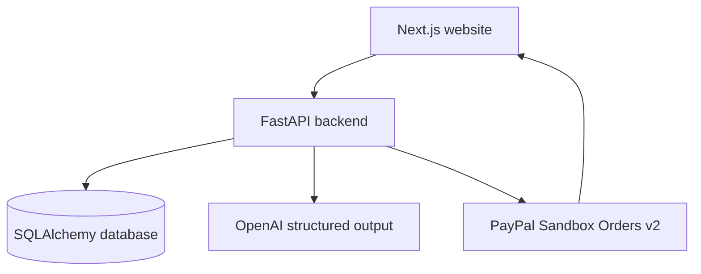

# Architecture

## The four parts
The frontend is what the user sees. FastAPI is the Python service that receives requests. The database remembers deals across restarts. External services provide AI suggestions and sandbox payment processing.

## Data model
- **Deal**: participants' display names, asking price, private minimum, brief, current version and checkout lock. This demo has one freelancer account; client identity is a private invitation capability, not an email-verified account.
- **Offer**: immutable JSON terms with a unique deal/version pair. Rejection is metadata; historical terms never change.
- **Approval**: unique offer/role pair. A client cannot select their role in a request body.
- **Payment**: unique deal and offer linkage, unique PayPal order/capture IDs, persistent UUID used to derive provider idempotency keys, verified payment date.
- **Event**: shared discussion and timeline. Secret tokens and private minimums are never events.

Money is stored as integer cents; $250 is 25000. Decimal formatting is used for PayPal. No float determines payment amounts. Pydantic rejects negative amounts, extra request fields, unsupported currencies and invalid timelines.

## Approval and payment states
A new proposal requires two new approvals. The browser supplies a version number; the backend checks it is still current. The payment route reads amount and currency directly from that proposal. The client alone can request checkout.

Creating the first payment row locks terms and commits the persistent request key before calling PayPal. A row update serializes mutations in PostgreSQL and SQLite. PayPal retries reuse the same create/capture request IDs. Unique constraints prevent duplicate local records. Creation retry is blocked after five hours to avoid assuming provider idempotency lasts forever.

Capture first queries the stored PayPal order. If already completed, the backend reconciles the returned capture without calling capture again. If approved, it captures with the persistent key. Paid requires matching order ID, proposal reference, currency, amount and a COMPLETED capture. A pending response, timeout or return URL is not success.

Cancellation records an exit only after querying PayPal; it does not void or refund an order. The existing order is retained. Returning to checkout resumes that order, with terms still frozen. This conservative rule avoids changing the contract beneath an outstanding checkout.

## Security boundaries
The freelancer token is an environment secret; its value is never sent by the API. Client invitation tokens contain cryptographic randomness and only their SHA-256 digest is stored. The link uses a URL fragment that is removed after reading. The browser stores the access capability in sessionStorage; treat it as a credential. XSS would threaten it, so React renders text without raw HTML. Invitation rotation revokes the old link.

CORS permits only the configured frontend origin. API authorization is still enforced independently. Requests do not use ambient cookies, so another origin cannot make authenticated requests without the token. AI schema output is untrusted; it cannot call approval or checkout routes. Private minimums are omitted from model context. AI requests are limited to 20 per deal per hour; public hosting should also apply edge limits to all routes.

## Deliberate simplifications
Single merchant, single currency, one full upfront payment; SQLite for the local starter and PostgreSQL for deployment. No real money, marketplace onboarding, refunds, webhooks, disputes or escrow. No production identity proof. Proposal terms are not legal advice.

Future changes: account login, migrations, background reconciliation and verified webhooks, invitation expiry, pagination and production monitoring. These are not currently implemented.
